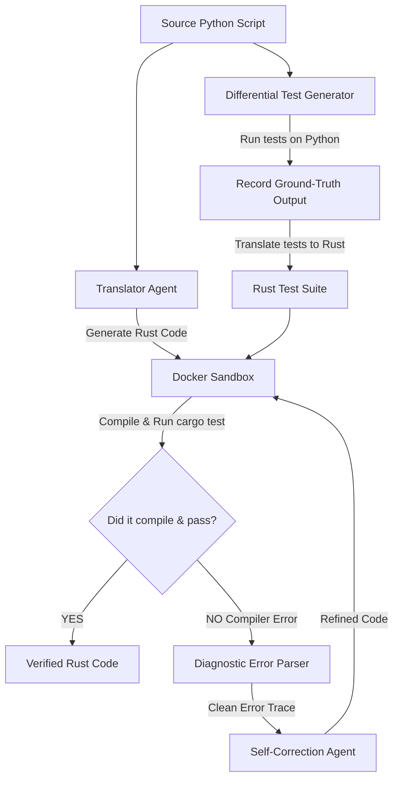

# A Closed-Loop Agentic Framework for Verifiable Code Translation

> **Converting legacy Python code to fast, memory-safe Rust using AI agents that learn from compiler execution feedback.**

[](file:///c:/Users/keert/OneDrive/Desktop/final%20project)
[](file:///c:/Users/keert/OneDrive/Desktop/final%20project)
[](file:///c:/Users/keert/OneDrive/Desktop/final%20project)
[](file:///c:/Users/keert/OneDrive/Desktop/final%20project)

---

## What is this project about?

Imagine asking an AI to translate a recipe from English to French. If it gets a word slightly wrong, you still get a decent meal. But translating **Python code into Rust** is like giving that recipe to a strict head chef who will throw out the entire dish if a single comma is misplaced!

**Python** is flexible and forgiving, while **Rust** is extremely strict about memory safety (thanks to its famous *borrow checker*). 

When standard AI models (like GPT-4 or Claude) translate code in one go (*one-shot*), they often generate code that fails to compile or contains hidden logic bugs. Because the AI never actually runs the code during generation, it has no way of knowing it made a mistake.

### Our Solution
We built an **automated, multi-agent AI framework** that doesn't just guess—it **runs, tests, and self-corrects** the translated code inside a safe container until it compiles and passes all unit tests perfectly!

---

## How It Works (The 4 Key Steps)



1. **Translator Agent**: Takes your source Python code and generates an initial Rust translation.
2. **Differential Test Generator**: Writes unit tests and runs them on your original Python code *first* to make sure we know what the correct output looks like. Then it translates those tests to Rust (preventing the AI from writing biased tests).
3. **Docker Sandbox**: Safely compiles and executes the Rust code using `rustc` and `cargo test` in an isolated container.
4. **Diagnostic Error Parser & Self-Correction Agent**: If the compiler complains or tests fail, our error parser extracts the exact problem (like borrow checker errors) and hands it back to the AI agent to fix it. This loop repeats until the code passes!

---

## Key Features

- **Smart Feedback Loop**: Replaces blind AI guessing with iterative compiler-driven debugging.
- **No Test Bias**: Validates unit tests on original Python code first, preventing the AI from writing "fake" tests that pass buggy code.
- **Safe & Sandboxed**: Uses Docker so AI-generated code never risks your local operating system.
- **Empirical Proof**: Measures real success using compilation rates, test pass rates, and iteration counts.

---

## Tech Stack & Tools

- **Languages**: Python 3.10+, Rust (`rustc`, `cargo`)
- **AI Models**: OpenAI GPT-4o / DeepSeek-Coder / Ollama (Local Models)
- **Agent Frameworks**: Custom Async Python / LangChain
- **Sandboxing**: Docker Engine
- **Datasets**: HumanEval (Python to Rust), CodeXGLUE

---

## Repository Structure

```text
final project/
├── Abstract . Code Translation.pdf  # Project Registration Form & Formal Abstract
├── Base paper .pdf                  # Core foundational reference paper
├── Reference paper 1 .pdf           # Reference paper 1
├── Reference paper 2.pdf           # Reference paper 2
├── Reference paper 3.pdf           # Reference paper 3
├── Reference paper 4.pdf           # Reference paper 4
├── Reference paper 5 .pdf           # Reference paper 5
└── README.md                        # Project documentation (This file)
```

---

## How We Measure Success

We evaluate our system using three clear metrics:
1. **Compilation Success Rate (CSR %)**: The percentage of translated Rust programs that compile without errors.
2. **Test Pass Rate (TPR %)**: The percentage of programs that pass all unit tests.
3. **Average Refinement Count ($k$)**: How many feedback loops it took on average to fix the code (capped at 5 tries).

---

## Key Literature & References

Our work builds on research in AI debugging, code generation, and multi-agent systems:

1. **Self-Debug** *(Chen et al., 2023)* - Teaches LLMs to debug code using compiler execution traces.
2. **Self-Refine** *(Madaan et al., 2023)* - Iterative code refinement using self-feedback.
3. **ChatDev** *(Qian et al., 2023)* - Multi-agent collaboration for software development.
4. **TransCoder** *(Roziere et al., 2020)* - Unsupervised translation baseline between programming languages.
5. **CodeXGLUE** *(Lu et al., 2021)* & **HumanEval** *(Chen et al., 2021)* - Core benchmark datasets.

---

## Project Team & Supervision

**Institution**: Vasireddy Venkatadri Institute of Technology (VVIT), Nambur, Guntur  
**Department**: Department of Artificial Intelligence & Machine Learning (AIML)  
**Batch ID**: `AIML – B-14`

| S. No. | Regd. No. | Student Name | 
| :---: | :---: | :--- |
| 1 | `23BQ1A6189` | **Mothukuri Keerthi Medha** | 
| 2 | `23BQ1A6186` | **Medam Venkata Ajay Kumar Reddy** | 
| 3 | `23BQ1A6108` | **Karumuri Satya Sri** |
| 4 | `23BQ1A6129` | **Korada Vamsi** | 

**Project Guide**: **Dr. D Murali Krishna Reddy**
