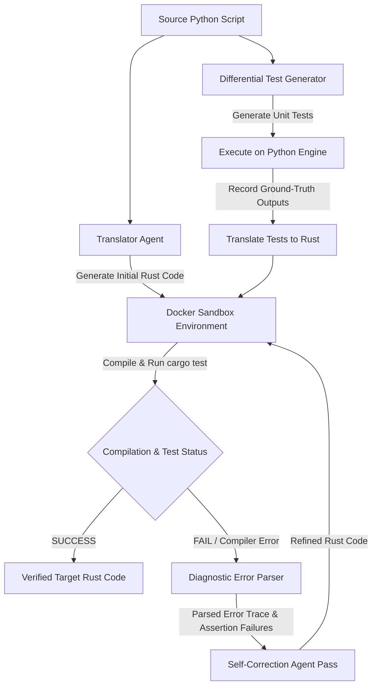

# A Closed-Loop Agentic Framework for Verifiable Code Translation

[](file:///c:/Users/keert/OneDrive/Desktop/final%20project)
[](file:///c:/Users/keert/OneDrive/Desktop/final%20project)
[](file:///c:/Users/keert/OneDrive/Desktop/final%20project)
[](file:///c:/Users/keert/OneDrive/Desktop/final%20project)

---

## 📌 Abstract & Overview

Software codebase modernization—such as translating legacy systems from **Python** to modern, memory-safe, high-performance languages like **Rust**—is critical for application safety and execution speed. While Large Language Models (LLMs) exhibit strong capabilities in code translation, single-pass (*one-shot*) translations frequently produce syntactically invalid or logically flawed code. 

This issue is amplified when target languages enforce strict compile-time invariants, such as Rust’s borrow checker and type system. Because LLMs generate code staticaly without execution feedback during inference, they cannot independently verify correctness.

This project presents an **automated, closed-loop program translation framework** leveraging sandboxed execution feedback and multi-agent collaboration:
1. **Translator Agent**: Generates initial target language code (Rust) from source scripts (Python).
2. **Differential Testing Generator**: Mitigates *test translation bias* (where LLMs write biased unit tests overlooking their own bugs) by executing generated unit tests on the source script first to establish verified ground-truth behavior, then translating the tests to Rust.
3. **Sandboxed Execution Engine**: Compiles and executes translated code inside a secure Docker container to prevent untrusted execution.
4. **Diagnostic Error Parser & Self-Correction Loop**: Isolates compile-time traces (`rustc` errors) and assertion failures, feeding clean structured diagnostics back to the translator agent for iterative refinement until execution succeeds.

---

## 🏗️ System Architecture



---

## ✨ Key Features

- 🔄 **Iterative Multi-Agent Refinement**: Replaces rigid single-pass LLM translation with an adaptive feedback-driven agent loop.
- 🛡️ **Differential Testing & Bias Mitigation**: Ensures unit tests are validated on the source implementation before target language assertion.
- 🐳 **Secure Docker Sandbox**: Safely isolates code compilation (`rustc`), linking, and test execution (`cargo test`) inside secure containers.
- 🔍 **Fine-Grained Error Diagnostics**: Extracts precise compiler error codes (e.g., borrow checker `E0382`, lifetime mismatches) and test failure stack traces.
- 📊 **Empirical Evaluation**: Evaluates success rate across compilation pass rate, test pass rate, and average refinement iterations.

---

## 🛠️ Tech Stack & Dependencies

- **Primary Languages**: Python 3.10+, Rust (`cargo`, `rustc`)
- **LLM Orchestration**: Python (LangChain / CrewAI / Custom Async Agent)
- **Model Support**: OpenAI GPT-4o / Claude 3.5 Sonnet / DeepSeek-Coder / Ollama (Local LLMs)
- **Containerization**: Docker Engine (Isolated Linux Container for `rustc` sandbox)
- **Testing Frameworks**: `pytest` (Python), `cargo test` (Rust)
- **Benchmark Datasets**: HumanEval (Python to Rust), CodeXGLUE

---

## 📁 Repository Structure

```text
final project/
├── Abstract . Code Translation.pdf  # Project Registration Form & Formal Abstract
├── Base paper .pdf                  # Core foundational reference paper
├── Reference paper 1 .pdf           # Reference paper 1
├── Reference paper 2.pdf           # Reference paper 2
├── Reference paper 3.pdf           # Reference paper 3
├── Reference paper 4.pdf           # Reference paper 4
├── Reference paper 5 .pdf           # Reference paper 5
└── README.md                        # Project documentation (This file)
```

---

## 🚀 Setup & Installation (Upcoming Implementation)

### Prerequisites
- Python 3.10 or higher
- Rust toolchain (`rustup`, `cargo`, `rustc`)
- Docker Desktop installed and running
- API Keys for LLM Provider (e.g. OpenAI / Anthropic / Local Ollama instance)

### Installation
```bash
# Clone the repository
git clone https://github.com/your-username/verifiable-code-translation.git
cd verifiable-code-translation

# Create and activate Python virtual environment
python -m venv venv
source venv/bin/activate  # On Windows: venv\Scripts\activate

# Install dependencies
pip install -r requirements.txt
```

---

## 📈 Evaluation Metrics

The proposed framework is evaluated using:
1. **Compilation Success Rate (CSR)**: Percentage of translated programs that successfully compile with `rustc`.
2. **Functional Correctness / Test Pass Rate (TPR)**: Percentage of programs that pass all differential unit tests.
3. **Average Refinement Iterations ($k$)**: Mean number of feedback iterations required to produce verified code.

---

## 📚 References & Literature Base

1. **X. Chen et al. (2023)** - *"Teaching Large Language Models to Self Debug"*, arXiv:2304.05128.
2. **A. Madaan et al. (2023)** - *"Self Refine: Iterative Refinement with Self Feedback"*, NeurIPS.
3. **H. Le et al. (2022)** - *"CodeRL: Collaborating Code Generation and Program Evaluation with Deep Reinforcement Learning"*, NeurIPS.
4. **B. Roziere et al. (2020)** - *"Unsupervised Translation of Programming Languages"*, NeurIPS.
5. **A. Zhou et al. (2023)** - *"Language Agent Tree Search as a Generalist Policy for Code Generation"*, arXiv:2310.04406.
6. **Y. Pan et al. (2023)** - *"Automatically Translating Programs Between Languages: A Survey"*, arXiv:2308.03310.
7. **C. Qian et al. (2023)** - *"Communicative Agents for Software Development (ChatDev)"*, arXiv:2307.07924.
8. **C. S. Xia & L. Zhang (2023)** - *"Keep the Conversation Going: Fixing Bugs with ChatGPT Using Conversational Automated Program Repair"*, arXiv:2304.00385.
9. **J. Zhang et al. (2023)** - *"Self Edit: Fault Aware Code Editor for Code Generation"*, ACL.
10. **S. Lu et al. (2021)** - *"CodeXGLUE: A Machine Learning Benchmark Dataset for Code Understanding and Generation"*, IJCAI.
11. **M. Chen et al. (2021)** - *"Evaluating Large Language Models Trained on Code (HumanEval)"*, arXiv:2107.03374.
12. **B. Roziere et al. (2021)** - *"Leveraging Source to Source Translation for Code Security"*, arXiv:2110.06778.

---

## 👥 Project Team & Supervision

**Institution**: Vasireddy Venkatadri Institute of Technology (VVIT), Guntur  
**Department**: Department of Computer Science & Engineering - Artificial Intelligence & Machine Learning (AIML)  
**Batch ID**: `AIML – B-14`

| S. No. | Regd. No. | Student Name |
| :---: | :---: | :--- |
| 1 | `23BQ1A6189` | **Mothukuri Keerthi Medha** |
| 2 | `23BQ1A6186` | **Medam Venkata Ajay Kumar Reddy** |
| 3 | `23BQ1A6108` | **Karumuri Satya Sri** |
| 4 | `23BQ1A6129` | **Korada Vamsi** |

**Project Guide**: **Dr. D Murali Krishna Reddy**
